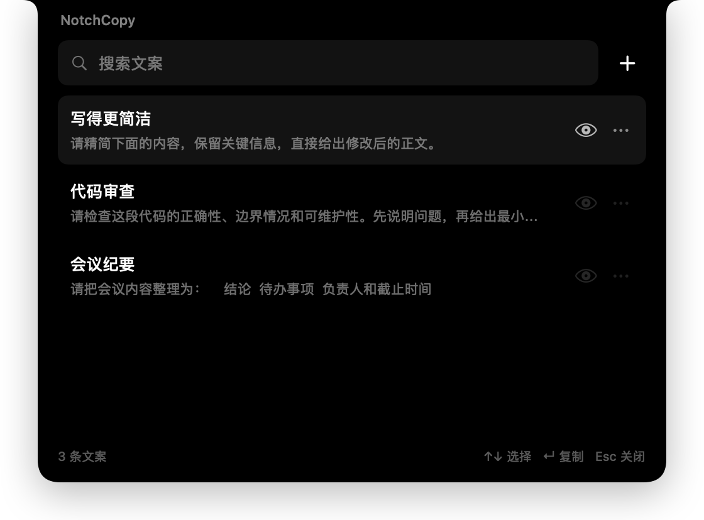

# NotchCopy · 刘海文案

**常用文案，随手复制。**

一个原生 macOS 文案工具。鼠标靠近刘海下沿，展开你的提示词、回复模板或常用文本；点击复制，面板自动收起，回到原窗口继续工作。

平时完全隐藏。没有常驻黑条，也没有自动采集的剪贴板历史。



## 下载

前往 [Releases](https://github.com/StarSure/NotchCopy/releases/latest) 下载 `NotchCopy-…-universal.zip`，解压后将 `NotchCopy.app` 放入「应用程序」。

- macOS 14 或更新版本；通用包包含 Apple Silicon 和 Intel 两种架构。
- 当前公开构建采用本地 ad-hoc 签名，尚未经过 Apple 公证，其他 Mac 首次打开可能受到 Gatekeeper 拦截。也可以按下文自行编译。
- 无账号、无订阅、无第三方运行依赖。

## 使用

| 操作 | 结果 |
| --- | --- |
| 鼠标在刘海下沿中央短暂停留 | 展开文案，保持原应用焦点 |
| `Control + Option + V` | 在任意应用呼出或关闭 |
| 点击一条文案 | 复制完整正文，短暂反馈后收起 |
| `↑` / `↓`，然后 `Return` | 选择并复制搜索结果 |
| 行末的眼睛图标 | 查看长文案全文，保留换行 |
| 行末的 `…` | 编辑、移到最上面、删除 |
| `Esc` | 收起面板 |

展开后可直接搜索标题和正文。点击右上角 `+` 新增文案；编辑窗口支持多行、`Command + S` 保存和未保存修改提示。

上方连接外接屏时，悬停区位于刘海下沿附近，与屏幕交界留出距离。已进入外接屏的鼠标不会触发内置屏面板。程序不会锁定、移动鼠标或修改显示器排列；正常跨屏移动保留。无物理刘海的 Mac 也可使用屏幕顶部中央的隐藏热区。

如果快捷键被其他应用占用，菜单会显示提示，仍可使用悬停或菜单入口。程序不默认开机启动。

## 数据与隐私

- 文案保存在 `~/Library/Application Support/NotchCopy/snippets.json`，与此前本地试用版兼容。
- 不读取剪贴板历史；只有你点击复制时才写入系统剪贴板。
- 无网络请求、无分析统计、无云端同步，也不请求辅助功能权限。
- 编辑前保留每日备份：`Backups/snippets-YYYY-MM-DD.json`，保存当日首次修改前的内容。可从菜单打开数据与备份文件夹。
- 仓库和安装包不包含作者个人文案。全新安装从空列表开始；[示例文件](Examples/snippets.example.json)仅供手动参考。

## 从源码构建

需要完整 Xcode 16 或更新版本提供的 Swift 6 工具链；Swift Package Manager 无需下载第三方包。

```sh
git clone https://github.com/StarSure/NotchCopy.git
cd NotchCopy
swift test
Scripts/build.sh
open dist/NotchCopy.app
```

构建 Apple Silicon / Intel 通用包：

```sh
Scripts/build.sh --universal
```

应用与 ZIP 输出到 `dist/`，并附带 SHA-256 校验文件。具备自己的 Developer ID 时，可通过 `CODESIGN_IDENTITY` 指定签名身份；脚本不会自动提交 Apple 公证。

正式签名、公证、附加票据与重新打包流程见 [Apple 公证指南](docs/NOTARIZATION.md)。可先执行 `python3 Scripts/notarize.py --plan` 查看计划；实际提交需要有效会员、本机 Developer ID Application 证书和 Keychain 认证。

## 项目结构

- `NotchController`：窗口生命周期、显示器变更、复制后收起与焦点恢复。
- `PointerWatcher` / `NotchEntryLayout`：停留判定、隐藏触发区与跨屏边界。
- `SnippetStore`：本机 JSON、搜索、去重、编辑和每日备份。
- `NotchView` / `SnippetEditorWindow`：列表、全文预览与独立编辑窗口。
- `InteractionPolicy`：选择范围与焦点恢复规则，可独立测试。

详见 [架构说明](docs/ARCHITECTURE.md) 和 [参与开发](CONTRIBUTING.md)。

## 开源与致谢

NotchCopy 由 StarSure 维护，部分基础组件改编自 [akalikbergenov/cyclop](https://github.com/akalikbergenov/cyclop)。项目保留原始 MIT 许可和来源说明，不包含 Cyclop 的音乐、日历、翻译等模块或原图标。

使用 [MIT License](LICENSE) 发布，改编范围见 [NOTICE](NOTICE)。
